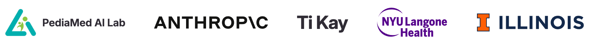

  <picture>
    <source media="(prefers-color-scheme: dark)" srcset="superderm-lockup-reversed.svg">
    
  </picture>

<b>An open platform and community for clinical skin photographs</b>

  <a href="https://superderm.org">Website</a> ·
  <a href="https://github.com/SuperDerm/SuperDerm-Release/releases/tag/424k-v0.1">SuperDerm-424K v0.1</a> ·
  <a href="https://github.com/SuperDerm/SuperDerm-Release">Releases</a>

A case documented by one clinical team can help another, far from specialist care, think of a diagnosis it might
otherwise miss. SuperDerm brings clinicians, students and researchers together around clinical photographs of common
and rare skin diseases, and releases everything openly: data, models, code and evaluation.

- **[SuperDerm-Release](https://github.com/SuperDerm/SuperDerm-Release)**: SuperDerm-424K data releases, the
  214-diagnosis taxonomy, the community scorer, and the SuperDerm VLM and full system when they are open-sourced.
- **[superderm.org](https://superderm.org)**: teaching cases for junior doctors and medical students, ways to
  contribute, data, models, challenges and the community.

  <picture>
    <source media="(prefers-color-scheme: dark)" srcset="organizers-dark.png">
    
  </picture>

For research discussion only: nothing from SuperDerm, including model outputs, is medical advice or a medical diagnosis.
